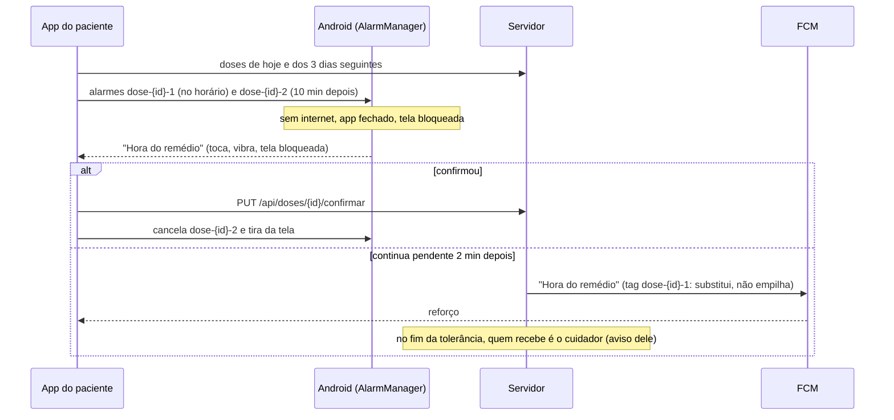

# Lembrete de dose no aparelho do paciente

O paciente precisa ser lembrado **na hora da dose**, com o app fechado, o celular bloqueado e sem internet (DRS,
UC-006, passo 1). Antes, só o cuidador recebia push; o paciente só via a dose se abrisse o app.

A solução tem duas camadas independentes: um alarme agendado no próprio aparelho (a principal) e um push do servidor
(a reserva). No APK com o módulo nativo, a camada A é um **alarme que toca até a dose ser confirmada** (seção
[Alarme da dose](#alarme-da-dose-toca-até-confirmar)); sem ele (Expo Go, web), ficam os dois lembretes descritos abaixo.

## Camada A: lembrete agendado no aparelho (principal)

- **O que agenda:** para cada dose PENDENTE, duas notificações locais:
  - **lembrete 1**, no horário: "Hora do remédio" e "Tomar Losartana às 08:00";
  - **lembrete 2**, 10 minutos depois: "Você ainda não confirmou o remédio" e "Tomar Losartana às 08:00. Toque para
    confirmar." Só entra se a dose ainda puder ser confirmada naquela hora.
- **Janela:** doses das próximas **72 horas**, no máximo **60 notificações** agendadas (as mais próximas primeiro).
  Identificador fixo por dose e tipo (`dose-{id}-1`, `dose-{id}-2`): sincronizar de novo substitui, nunca duplica.
- **Canal Android `lembrete-dose` ("Lembrete de remédio"):** importância máxima, som padrão tocado no volume de
  **alarme** (com `enforceAudibility`), vibração forte (três pulsos de 0,6 s), luz, conteúdo visível na tela bloqueada
  e `bypassDnd` desligado (o Não Perturbe só é burlado se o próprio paciente liberar). O canal `alertas-dose` do
  cuidador não muda.
- **Relógio:** os horários das doses estão no relógio do servidor. O alarme é agendado no relógio do aparelho, com a
  diferença medida pelo header `Date` das respostas (`serverClock`): um celular 5 minutos adiantado toca às 08:00 do
  servidor, não às 08:00 dele. No demo, o relógio simulado é a referência.
- **Quando sincroniza** (`sincronizarLembretesDoPaciente()` em `src/lib/reminders.ts`, única e idempotente):
  - ao abrir o app e ao voltar ao primeiro plano (`useRefreshOnAppActive`, de `useScreenActivity`);
  - a cada 5 minutos com o app aberto;
  - quando o início do paciente (que atualiza a lista do dia a cada minuto) vê a lista mudar: um remédio cadastrado ou
    um horário alterado pelo cuidador com o app do paciente aberto ganha o alarme na hora, sem esperar os 5 minutos;
  - quando a sessão muda: pareamento, saída, desconexão, troca de perfil (fora do perfil do paciente, cancela tudo);
  - quando chega o reforço do servidor com o app aberto;
  - em segundo plano, pelo `expo-background-task` (WorkManager), com o intervalo mínimo do Android (15 minutos), para
    renovar a janela mesmo que o paciente fique dias sem abrir o app (`src/lib/reminderTask.ts`).
- **Sem internet:** a sincronização que não consegue buscar as doses não cancela nada (o paciente continua sendo
  lembrado). Se só parte das listas chegou, só são cancelados os lembretes das doses que vieram confirmadas.
- **Confirmar a dose** cancela os dois lembretes dela na hora e tira da tela o que já apareceu.
- **Toque na notificação:** abre a tela da dose, com o início por baixo. Se a regra de tolerância pede o PIN, a tela
  do PIN vem antes, e a dose abre depois do desbloqueio (o lembrete não contorna o PIN).
- **Cuidador:** o perfil do cuidador nunca agenda lembrete de dose (nem consulta as doses para isso). Ele continua
  recebendo só o aviso de dose não confirmada.
- **Demo:** no modo demonstração os lembretes também são agendados, a partir dos dados de demonstração (o alarme toca
  quando o relógio simulado chega ao horário). A tarefa em segundo plano não roda no demo: os dados vivem só na memória
  do app aberto.

O plano é puro (`src/lib/reminderPlan.ts`), o agendamento embrulha o `expo-notifications` (`src/lib/reminderCore.ts`)
e a ligação com a sessão fica em `src/lib/reminders.ts`. Testes: `tests/lembrete.test.ts` e
`tests/lembreteSessao.test.ts`.

## Alarme da dose (toca até confirmar)

Pedido para o paciente não perder a dose: no horário, o celular toca **som de alarme sem parar** e só para quando a
dose é confirmada no app (ou quando acaba o prazo de confirmação). O paciente pode adiar 5 minutos.

Código nativo próprio, no módulo local `modules/medcare-alarmes` (Kotlin), porque o `expo-notifications` não faz som
contínuo nem tela cheia: `AlarmesDaDose.kt` (regras), `AlarmeActivity.kt` (tela), `ReceptorDeAlarme.kt` (disparo,
soneca e reinício do aparelho) e `AlarmeDeDose.kt` (dados gravados). No app, `src/lib/doseAlarm.ts` monta o plano e
`reminders.ts` sincroniza.

| Momento | O que acontece |
|---|---|
| Horário da dose | `AlarmManager.setAlarmClock` dispara (tratado como despertador: o Doze e a economia de bateria não adiam). Notificação no canal "Alarme do remédio": som de alarme em repetição (`FLAG_INSISTENT`, volume de alarme), vibração, fixa (não sai deslizando). Com o celular bloqueado ou apagado, a tela acende e abre a **tela do alarme** por cima do bloqueio |
| Tela do alarme | Letras grandes, o remédio e o horário, e dois botões: **Tomar o remédio** e **Adiar 5 minutos**. Os mesmos dois botões aparecem na notificação |
| "Tomar o remédio" | Cala o alarme por 3 minutos (a notificação fica, sem som: "Confirme no app: o alarme volta a tocar às HH:mm"), pede o desbloqueio e abre o app **na tela de confirmar a dose** (passando pelo PIN, se houver) |
| "Adiar 5 minutos" | Cala e tira a notificação; toca de novo 5 minutos depois |
| Sem resposta | Toca de novo a cada 2 minutos (também se o paciente só abrir a gaveta de notificações, o que cala o som insistente) |
| Dose confirmada | O app cancela o alarme na hora (tela de confirmar, ou na sincronização seguinte se foi confirmada em outro lugar) |
| Fim do prazo de confirmação | O alarme some sozinho: a dose não pode mais ser confirmada |
| Celular reiniciado ou app atualizado | Os alarmes gravados são programados de novo; um que ficou para trás e ainda está no prazo toca na hora |

- **Plano:** uma entrada por dose PENDENTE das próximas 72 horas cujo prazo ainda não passou, no relógio do aparelho
  (corrigido pelo do servidor). Uma dose cujo horário já passou continua no plano enquanto pode ser confirmada: o nativo
  reconhece o mesmo horário e mantém o estado (tocando, adiado). Horário alterado pelo cuidador recomeça o alarme.
- **No lugar dos dois lembretes comuns:** com o alarme ativo, os lembretes `dose-{id}-1` e `dose-{id}-2` do
  `expo-notifications` são cancelados (o alarme já insiste). Se o nativo falhar, eles voltam na mesma sincronização.
- **Reforço do servidor:** com o app aberto, não aparece para uma dose que tem alarme. Com o app em segundo plano, o
  Android mostra o push do servidor como notificação separada (ela continua sendo a reserva se o alarme não tocar).
- **Permissão nova:** `USE_FULL_SCREEN_INTENT` (tela cheia por cima do bloqueio). No Android 14+ o paciente pode
  desligá-la; o app mostra o aviso "O alarme do remédio pode não aparecer com o celular bloqueado. Toque aqui para
  permitir" e abre a tela certa. Sem ela, o alarme ainda toca e aparece no topo da tela, só não acende a tela cheia.
- **Sem serviço em primeiro plano:** a repetição a cada 2 minutos é feita pelo próprio `setAlarmClock`, e a
  `FOREGROUND_SERVICE` continua bloqueada.

## Camada B: reforço pelo servidor (reserva)

Se o celular reiniciou, o fabricante apagou o agendamento ou a economia de bateria atrasou o alarme, o servidor reforça.

- O app registra o token FCM do aparelho no paciente (`PUT /api/pacientes/me/fcm-token`, com o JWT do paciente) depois
  do pareamento e a cada abertura, e remove (`DELETE`) ao trocar de perfil e em "Esqueci meu PIN". Na desconexão e na
  desvinculação, o próprio servidor apaga o token.
- O job `LembreteDoPacienteJob` (a cada minuto, com ShedLock) procura doses **PENDENTES** cujo horário passou há pelo
  menos **2 minutos** e que ainda não chegaram ao **aviso ao cuidador** (horário + tolerância, pela `PoliticaDeJanela`).
  Grava o evento `LEMBRETE_PACIENTE` (um por dose e tipo, `ON CONFLICT DO NOTHING`) e envia pelo mesmo
  `EnvioDeAvisoService` e a mesma retentativa do aviso ao cuidador (até 5 tentativas, base de 5 minutos), que desiste
  quando a dose sai de PENDENTE ou chega ao aviso ao cuidador.
- Push com prioridade alta, canal `lembrete-dose` e **tag `dose-{id}-1`**, a mesma do lembrete local: se o lembrete do
  aparelho já está na tela, o Android troca um pelo outro em vez de empilhar. Com o app aberto, o reforço só aparece
  se o lembrete local da mesma dose não estiver na tela, e dispara a sincronização. Validade no FCM até o aviso ao
  cuidador.
- Sem a credencial do Firebase, o servidor só registra em log (sem o nome do remédio); a camada A continua valendo.

## Limites do Android e o que foi feito

| Limite | Efeito | O que o app faz |
|---|---|---|
| **Alarme exato** (Android 12+) | Sem a permissão "Alarmes e lembretes", o `expo-notifications` agenda o alarme como inexato e o Android pode atrasá-lo em vários minutos (até a próxima janela de manutenção do Doze). No Android 14+, ela vem **negada** em apps novos | Declara `SCHEDULE_EXACT_ALARM`; um módulo nativo local (`modules/medcare-alarmes`) confere `canScheduleExactAlarms()` e abre a tela certa. O paciente vê o aviso "O lembrete pode atrasar. Toque aqui para ativar". Quando a permissão é dada, os lembretes já agendados são agendados de novo (como exatos) |
| **Doze** (aparelho parado, tela desligada) | Adia o que roda em segundo plano | Alarme com `setExactAndAllowWhileIdle` (o que o `expo-notifications` usa quando o alarme exato é permitido) e push com prioridade alta |
| **Reiniciar o celular** | O Android apaga os alarmes | `RECEIVE_BOOT_COMPLETED`: o `expo-notifications` agenda tudo de novo ao ligar. O reforço do servidor cobre o intervalo |
| **Economia de bateria do fabricante** (Xiaomi, Samsung, Motorola etc.) | Pode parar o app à força e apagar alarmes e tarefas | Nos Ajustes do paciente, a orientação "Economia de bateria" com o botão que abre a página do app nas configurações ("Bateria" → "Sem restrições"). Não bloqueia o uso. O reforço do servidor cobre o que o fabricante apagar |
| **Notificações desligadas** (Android 13+ pede permissão) | Nada toca | Aviso grande no início e nos Ajustes do paciente: "O lembrete do remédio está desligado. Toque aqui para ativar" (pede a permissão ou abre as configurações) |
| **Tarefa em segundo plano** | O Android decide a hora exata (mínimo de 15 minutos, com rede e sem economia extrema) | É só a renovação da janela de 72 h; o lembrete em si é o alarme já agendado |

## Decisões

- **`SCHEDULE_EXACT_ALARM`, e não `USE_EXACT_ALARM`:** as duas permitem alarme exato, mas a política do Google Play
  reserva `USE_EXACT_ALARM` (concedida sem o usuário ver) a apps cuja função principal é despertador ou agenda. Lembrete
  de remédio é o caso típico de `SCHEDULE_EXACT_ALARM` com um fluxo guiado para o usuário liberar, que é o caminho
  recomendado pela documentação do Android para lembretes. `USE_EXACT_ALARM` fica bloqueada no manifesto.
- **Segundo lembrete 10 minutos depois:** perto o bastante para o paciente que não ouviu o primeiro (e longe do aviso
  ao cuidador, que vem no fim da tolerância, entre 5 e 120 minutos; o padrão é 30). Com tolerância menor que 10
  minutos, o segundo lembrete ainda toca, porque a dose continua confirmável (com atraso) até o encerramento.
- **Reforço do servidor 2 minutos depois do horário:** dá tempo ao alarme local (que toca no horário) e a quem confirma
  logo em seguida, e evita duas notificações no mesmo instante. Termina exatamente quando o aviso ao cuidador começa.
- **72 horas e 60 notificações:** cobre um fim de semana sem abrir o app e fica longe do limite de alarmes que o Android
  aceita por app (cerca de 500); com até 10 doses por dia, cabem os 3 dias.
- **Volume de alarme:** idosos costumam deixar o volume de notificação baixo ou no silencioso; o de alarme, não.
  O Não Perturbe continua respeitado.
- **Nome do remédio no texto:** o aparelho é do paciente, e é o que ele precisa para tomar a dose. Nada além do nome
  (sem dosagem ou observações). O aviso ao cuidador continua sem o nome do remédio (ver `docs/lgpd.md` do backend).

## Limites conhecidos

- Fabricantes que param o app à força (alguns Xiaomi, Huawei, Oppo, Vivo) podem apagar os alarmes até a próxima
  abertura do app. A orientação de bateria reduz o problema, e o reforço do servidor cobre quando há internet; sem
  internet **e** com o fabricante apagando os alarmes, o lembrete pode não tocar.
- O lembrete é agendado com o que o app sabia na última sincronização: um remédio cadastrado pelo cuidador enquanto o
  celular do paciente está sem internet só entra quando o app conseguir buscar as doses de novo.
- Dose confirmada pelo **cuidador** com o celular do paciente sem internet: o segundo lembrete local ainda pode tocar;
  ao abrir, a tela da dose mostra que ela já foi confirmada.
- Se o paciente trocar para o perfil do cuidador sem internet, o token do aparelho pode ficar no servidor até a
  próxima vez que o perfil do paciente for usado; o reforço do servidor ainda pode chegar nesse intervalo.
- O app só existe para Android; no iPhone e na web o lembrete é inerte.
- Alarme da dose: o Não Perturbe do aparelho continua mandando (o app não pede acesso a ele); com "alarmes permitidos"
  no Não Perturbe, que é o padrão da maioria dos aparelhos, o alarme toca.
- Alarme da dose confirmada pelo **cuidador** com o celular do paciente fechado: continua tocando até a próxima
  sincronização (abrir o app ou a tarefa em segundo plano); ao abrir, a tela da dose mostra que ela já foi confirmada.
